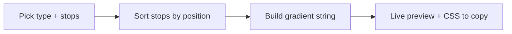

<p align="center"></p>

# GradLab 🌈

**Drag a few stops, get the CSS.** A tiny gradient builder with a live preview, so you can stop guessing angles and start copying code. ✨

No accounts, no build step, no dependencies. Everything runs in your browser.

## ✨ What you get

- 🎛️ **Linear, radial and conic** gradients
- 🎨 **2 to 6 color stops** with a color picker and a position slider for each
- 🔄 **Angle slider** for linear and conic gradients
- 🎲 **Surprise me** button for random combos
- 🧁 **6 presets** to start from: Ocean, Sunset, Aurora, Peach, Night, Candy
- 📋 **One-click copy** of the finished `background:` rule
- 🌙 **Dark and light themes**, keyboard friendly, reduced-motion aware

## 🚀 Run it

```bash
git clone https://github.com/CyberLoop-dev/gradlab.git
cd gradlab
# open index.html, or serve the folder:
python3 -m http.server 8000
```

## 🧭 How it works



## 📁 Project structure

```text
gradlab/
├── index.html
├── styles.css
├── app.js
└── assets/   # logo and README banner
```

## ⚠️ Known limitations

- Radial gradients are always `circle at center`; no shape or position controls yet.
- Colors are hex only, so no transparency yet.

## 💡 Ideas for later

- Alpha support and radial positioning
- Tailwind and SCSS export
- Shareable links

## 🤝 Contributing

Issues and pull requests are welcome. Keep it dependency-free.

## 📄 License

[MIT](LICENSE)
